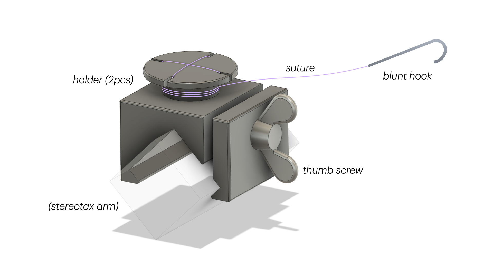
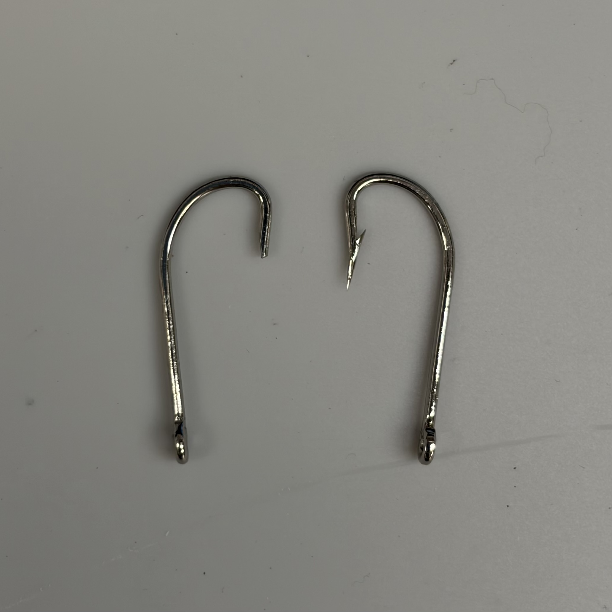
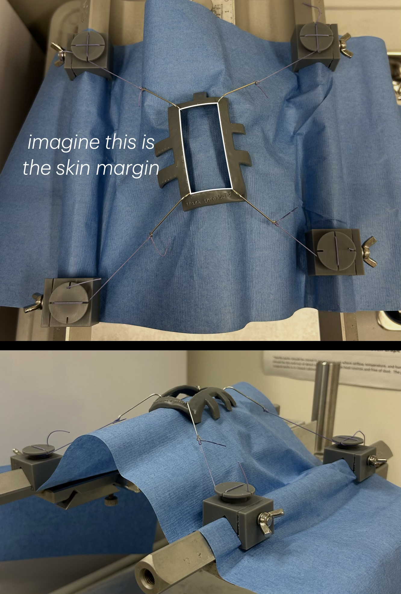

# 🎣 STRING: Stereotax-Tethered Retractor for Implanting Neurophysiology Gear

STRING is a retractor system designed for stereotaxic cranial implant surgeries in neurophysiology research. It is extremely low-profile, self-retaining, and allows for skin retraction in all directions.

The STRING retractor system consists of:

* a blunt skin hook, which hooks onto the skin margin;
* a thin string (suture) tied to the hook; and
* a 2-piece holder, which clamps onto the stereotax arm (over the surgical drape) and holds the string in place.

## Table of contents
- [About the design](#about-the-design)
- [Building STRING](#building-string)
- [Using STRING](#using-string)
- [Contact](#contact)

## About the design

STRING is inspired by the [Lone Star™ Retractor System](https://www.coopersurgical.com/brand/lone-star/). It applies the same principle but is adapted for stereotaxic cranial implant surgeries. Because the retractor strings are anchored to the stereotax arms, STRING provides sturdy, hands-free retraction while leaving more clearance around the surgical site.

## Building STRING

### 0. Gather tools and supplies

| | **Name** | **Qty** | **Purpose & Specifications** |
| --- | --- | --- | --- |
| **Holders** (4 sets) | Holder P1 | 4 | Custom part; STL and STEP files are in this repository. See the printing instructions below. |
| | Holder P2 | 4 | Custom part; STL and STEP files are in this repository. See the printing instructions below. |
| | Thumb screw | 4 | Clamps the holder onto the stereotax arm. M5 × ~10 mm. [Example product](https://www.mcmaster.com/92625A309/) |
| **Hooks & Strings** (semi-consumable) | Fishing hooks | Varies | Blunted to make the skin hooks. Stainless steel, with a gap of ~5-8 mm. [Example product](https://www.amazon.com/dp/B0FR7QF42M) |
| | Suture | Varies | To make the strings. Braided (e.g. silk, Vicryl), size from 3-0 to 2, length ~18 in; longer suture can be cut to length. No needle needed. |
| **Tools** | M5 tap | 1 | For threading the screw hole in the 3D-printed holder. |
| | Dremel with diamond cutting wheel | 1 | For blunting the fishing hooks. |

> [!NOTE]
> **3D Printing Instructions:**
> - **Material:** Use a tough material (e.g., Formlabs Tough 2000) so the holder doesn't snap under tension.
> - **Resolution:** High resolution isn't necessary; 0.05 mm works well.
> - **Supports:** Avoid putting too much support on the circular part of the holder. The small slits may not print cleanly otherwise.

> [!NOTE]
> To sterilize the parts for surgery use, you will also need various surgical and sterilization supplies (e.g. sterile gloves, sterilization pouches, gas sterilizer). These are not listed above. See [2. Sterilize and assemble](#2-sterilize-and-assemble) for details.

### 1. Prepare the holders and hooks

- Thread the hole in holder P1 using the M5 tap. The M5 thumb screws should be able to screw in nicely.
- Using the Dremel, grind off the sharp tip and barb on the fishing hooks and smooth the tip. The photo below shows a blunt hook (left) and the original fishing hook (right). Make as many hooks as you may need.

  

### 2. Sterilize and assemble

> [!CAUTION]
> Follow your institution's SOPs and consult your veterinary staff on which method is the most appropriate.

#### Option 1: Assemble *before* surgery

##### Option 1A: Assemble, then sterilize

> This method is simple and gives a longer sterile shelf life. However, commercial sutures are usually labeled "do not resterilize," and absorbable sutures (e.g., Vicryl) may degrade.

- Gas-sterilize the holders (P1, P2, and thumb screws). Pack the parts loosely assembled in the sterilization pouch so the gas can reach all surfaces.
- Prepare the hooks and suture:
  1. Wearing clean gloves, cut the suture to the desired length if needed.
  2. Tie one hook to each strand with a secure knot (e.g. an [improved clinch knot](https://www.animatedknots.com/improved-clinch-knot)).
  3. Place the assembled hooks in a gas sterilization pouch.
  4. Gas-sterilize the pouch.

##### Option 1B: Sterilize, then assemble

> This method avoids re-sterilizing the suture, but has a shorter sterile shelf life.

- Gas-sterilize the holders (P1, P2, and thumb screws). Pack the parts loosely assembled in the sterilization pouch so the gas can reach all surfaces.
- Prepare the hooks and suture:
  1. Gas-sterilize or autoclave the blunt hooks.
  2. Set up a sterile field on a clean table.
  3. Using aseptic technique, open the sterile hooks, sterile sutures, and a pair of sterile scissors onto the field. Optionally, add a sterile needle driver to grip the hooks while tying.
  4. Place a sterile specimen container next to the field with its lid loosened. Note that only the inside of the specimen container is sterile.
  5. Don sterile gloves.
  6. Cut the suture to the desired length if needed, then tie one hook to each strand with a secure knot (e.g. an [improved clinch knot](https://www.animatedknots.com/improved-clinch-knot)).
  7. Carefully place the assembled hooks inside the specimen container, close the lid tightly, and label it with the prep (and expiration) date.
  8. During surgery, open the container and have the scrubbed surgeon retrieve the hooks without touching the rim or outer surface.

#### Option 2: Assemble *during* surgery

> This method is safer than Option 1, but it takes up some time during the surgery while the subject is under anesthesia.

- Gas-sterilize the holders (P1, P2, and thumb screws). Pack the parts loosely assembled in the sterilization pouch so the gas can reach all surfaces.
- Gas-sterilize or autoclave the blunt hooks.
- Sutures should already come in sterile packs. Just bring them to the surgery.
- During surgery, the scrubbed surgeon assembles the hooks and suture. Cut the suture to the desired length if needed, then tie one hook to each strand with a secure knot (e.g., an [improved clinch knot](https://www.animatedknots.com/improved-clinch-knot)).

## Using STRING

> [!NOTE]
> This section assumes that everything has been appropriately sterilized for the surgery. For how to sterilize STRING, see [2. Sterilize and assemble](#2-sterilize-and-assemble).

1. Clamp the holders onto the stereotax arm, above the surgical drape.
2. Hook the skin margin, wrap the string around the holder's circular cleat a few times, then secure the string in one of the cleat's slits. A few wraps are usually enough to hold the string in place; if it slips, add more.
3. Adjust each string to apply only as much tension as needed for adequate exposure. To loosen or tighten, release the string from the slit, unwrap as needed, and re-secure it.

> [!CAUTION]
> Prolonged or excessive retraction can compromise blood flow to the skin margins. Only retract as long as necessary. Periodically check the skin margins and relax the strings as needed, following your institution's SOPs and your veterinary staff's guidance.

See demo photo below:

## Contact

For inquiries and suggestions, feel free to contact Yuelai Feng at yuelai.f@outlook.com.